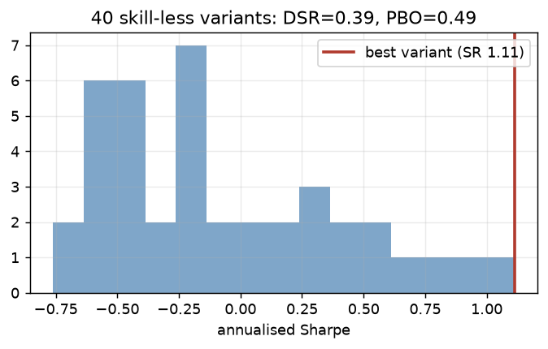
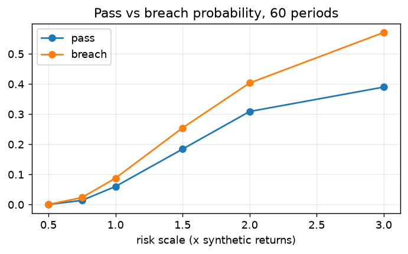
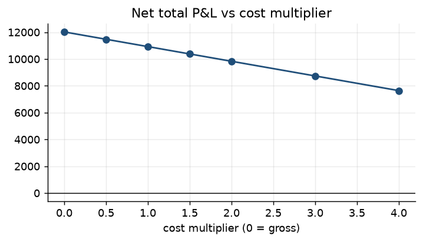
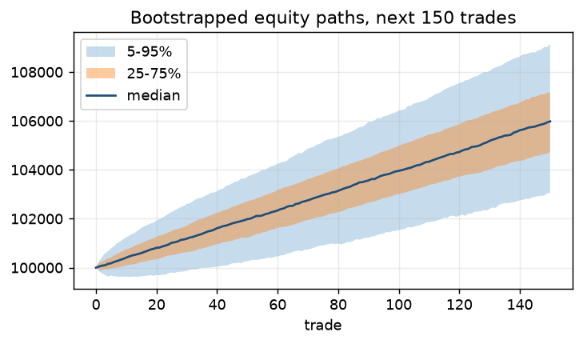
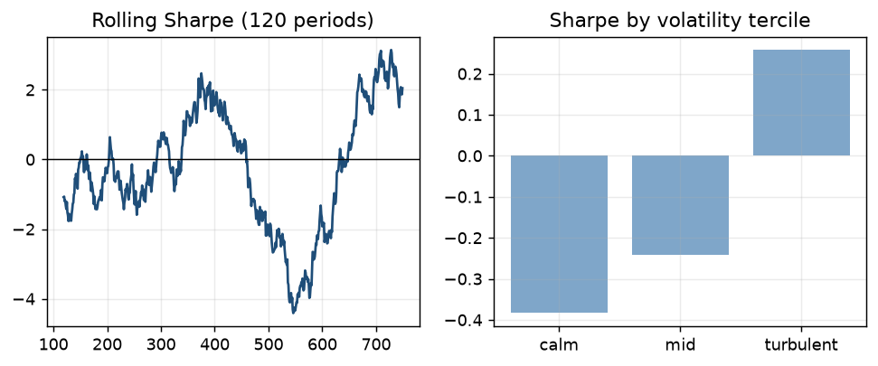
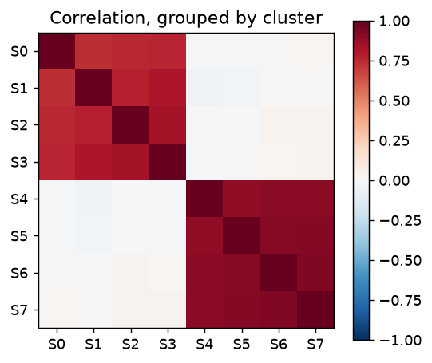

# quanthygiene

[](https://github.com/ImAilikesi/quant-research-tools/actions/workflows/ci.yml)


Research hygiene for systematic trading. Small, tested tools that answer the questions a backtest
usually skips: *Is this Sharpe real? Did I overfit? Do costs kill it? Would I have survived a
prop-firm drawdown rule? Are my FX pairs really diversified?*

> Research tools only. Not trading signals, not investment advice, no performance claims. Examples
> use synthetic data.

## Quickstart (30 seconds)

```sh
pip install git+https://github.com/ImAilikesi/quant-research-tools.git   # or: pip install -e .
quanthygiene tearsheet examples/synthetic_trades.csv --out tearsheet.html
quanthygiene dsr examples/synthetic_returns.csv --trials 40
```

```python
import numpy as np
from quanthygiene import robustness, risk

r = np.random.default_rng(0).normal(0.0007, 0.008, 750)          # per-period returns
robustness.bootstrap_ci(r, "sharpe", periods_per_year=252)        # how uncertain is the Sharpe?
robustness.deflated_sharpe_ratio(r, n_trials=40)["dsr"]           # still significant after 40 tries?
risk.simulate_rules(r, 60, risk.Rules(max_loss=0.10, daily_loss=0.05, profit_target=0.10))
```

## What each module answers

| Module | Question | CLI |
|---|---|---|
| `robustness` | How uncertain is my Sharpe? Is it significant after many trials (Deflated Sharpe)? How likely is overfitting (PBO via CSCV)? How much of my drawdown was trade-order luck? | `bootstrap`, `dsr`, `pbo`, `reshuffle` |
| `costs` | Does the edge survive spread, commission, slippage and swap? At what cost multiple does it vanish? How concentrated are profits? | `costs` |
| `risk` | Probability of breaching a static loss limit, trailing drawdown or daily loss before hitting a profit target (prop-firm style rules); risk of ruin | `breach`, `ruin` |
| `sizing` | Units for a risk budget, Kelly and fractional Kelly, volatility targeting | `size` |
| `validation` | Walk-forward splits and purged K-fold with embargo, free of look-ahead leakage | `splits` |
| `volatility` | Close-to-close, Parkinson, Garman-Klass and Yang-Zhang estimators | `vol` |
| `fx` | Quote-direction normalisation, PCA/correlation diversification check, currency exposure from pair positions | `fx-diversify` |
| `montecarlo` | What range of equity curves was plausible from my trades (confidence bands)? Chance of loss or a deep drawdown over the next N trades? | `mc-bands` |
| `regimes` | Does performance depend on calm vs turbulent markets (trailing-volatility terciles, no look-ahead)? | `regimes` |
| `rolling` | Is the edge stable through time? Rolling Sharpe, drawdown and hit rate | `rolling` |
| `tradelog` | R-multiples, holding time, win/loss streaks, MAE/MFE and winner capture | `tradelog` |
| `clustering` | Which strategies or assets are really the same bet (correlation clustering)? | `cluster` |
| `robustness.min_backtest_length` | How many years of data before a given Sharpe is believable after N trials? | `minbtl` |
| `report` | One-command HTML tearsheet from an equity, returns or trades CSV | `tearsheet` |

Input formats: a CSV with a `pnl` column (trades; optional `units`, `hold_days`, `entry_time`, `exit_time`, `risk`, `mae`, `mfe`), an
`equity` column, or a `returns` column (optional `date`). Every CLI command prints JSON.

## Example output

All figures are generated by `examples/make_figures.py` from synthetic data.








A full [example tearsheet](docs/example_tearsheet.html) is included (download and open locally).

## References

Bailey & Lopez de Prado, *The Deflated Sharpe Ratio* (2014); Bailey, Borwein, Lopez de Prado &
Zhu, *The Probability of Backtest Overfitting* (2017); Lopez de Prado, *Advances in Financial
Machine Learning* (2018); Garman & Klass (1980); Yang & Zhang (2000); Parkinson (1980).

## Development

```sh
pip install -e ".[dev]" && ruff check . && pytest
```

See [CONTRIBUTING.md](CONTRIBUTING.md) and [CHANGELOG.md](CHANGELOG.md). MIT licensed, by Aleksandr Shulga.
